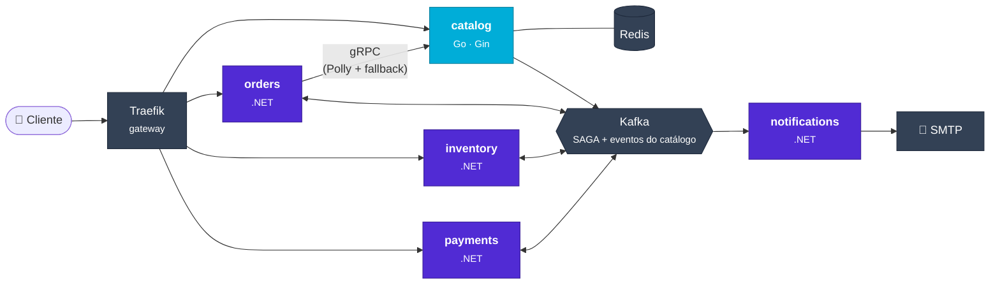
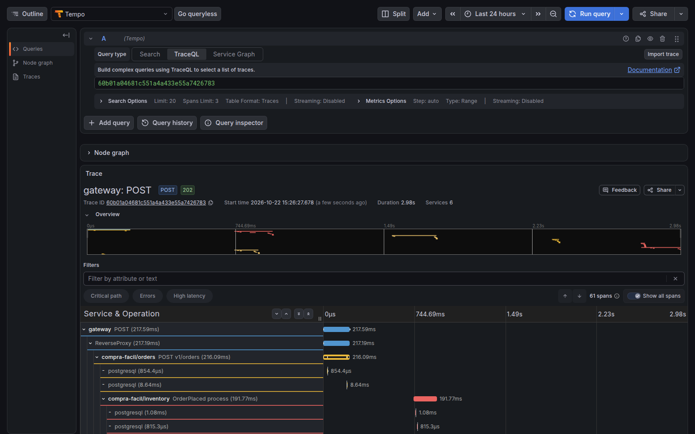
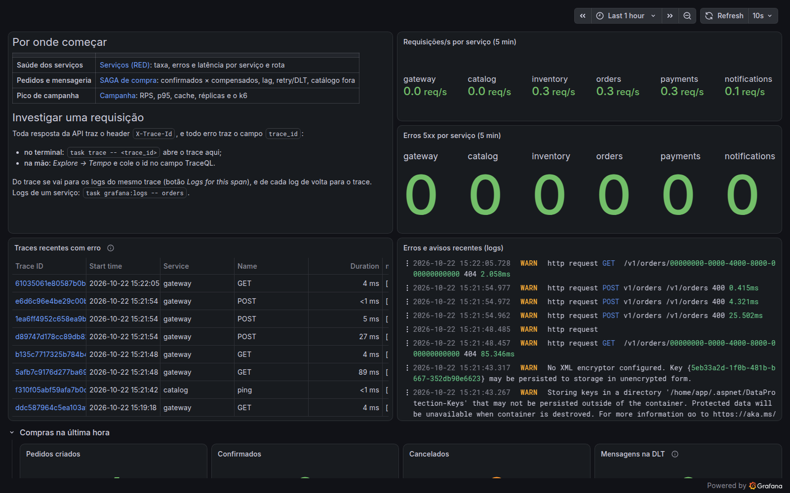

<div align="center">

# 🛒 CompraFácil

**Um e-commerce em microsserviços que aguenta o pico da campanha promocional escalando só o que precisa.**

Catálogo em **Go**, compras em **.NET**, SAGA coreografada sobre **Kafka**, observabilidade ponta a ponta com
**OpenTelemetry** e um pipeline de CI/CD por serviço.

[](https://github.com/mateus-vitor-ferreira-dev/compra-facil/actions/workflows/catalog.yml)
[](https://github.com/mateus-vitor-ferreira-dev/compra-facil/actions/workflows/orders.yml)
[](https://github.com/mateus-vitor-ferreira-dev/compra-facil/actions/workflows/inventory.yml)
[](https://github.com/mateus-vitor-ferreira-dev/compra-facil/actions/workflows/payments.yml)
[](https://github.com/mateus-vitor-ferreira-dev/compra-facil/actions/workflows/notifications.yml)
[](https://github.com/mateus-vitor-ferreira-dev/compra-facil/actions/workflows/contracts.yml)


[Início rápido](#-início-rápido) ·
[Arquitetura](#-arquitetura) ·
[Resultados](#-resultados) ·
[Decisões](#-decisões) ·
[Para o front](#-para-quem-consome-as-apis)

</div>

---

## O problema

A CompraFácil é a loja do trabalho *Monolito x Microsserviços* ([enunciado](docs/Trabalho_MonolitoXMicrosservicos.pdf)).
Em campanha promocional, a consulta ao catálogo cresce muito mais que o resto da loja, e o monolito só
aguenta escalando **tudo** junto. Dois times (catálogo e compras) dependem de **uma implantação conjunta**.

## A solução

Cada time ganhou os próprios serviços, banco, contrato e pipeline:

- O **catálogo** (Go) escala sozinho no pico, com cache Redis e preço de campanha calculado na leitura.
- As **compras** (.NET: pedidos, estoque, pagamentos, notificações) conversam por eventos, numa
  **SAGA coreografada** com compensação, sem orquestrador.
- **O pedido não cai se o catálogo cair**: prazo, retry com jitter e circuit breaker (Polly), com fallback
  para uma cópia local do catálogo que o orders mantém pelos eventos.
- **Nenhum evento se perde e nenhum efeito se repete**: outbox transacional, inbox por `event_id`,
  tópicos de retry e dead letter topic com reprocessamento.

O parecer da atividade, com a escolha entre as propostas e os critérios para avaliá-la, está em [`docs/parecer.md`](docs/parecer.md).

## Em números

| | |
|---|---|
| **p95 de 686 ms → 5 ms** no pico de 1.000 req/s, escalando **só o catálogo** de 1 para 3 réplicas (+0,27 núcleo de CPU) | [`docs/resultados-carga.md`](docs/resultados-carga.md) |
| **0 falhas** em 1.202 pedidos com o catálogo **derrubado no meio** do teste de carga | [`task chaos:catalog`](load-tests/k6/orders-catalog-down.js) |
| **~290 testes** automatizados: 168 em .NET (integração com Postgres, Redpanda e gRPC reais) e 120 em Go | `task test` |
| **5 serviços**, **5 pipelines** independentes e contratos versionados em gRPC, REST e eventos | [`.github/workflows`](.github/workflows) |
| Um pedido vira **um trace só**: 57 spans passando por 6 componentes | Grafana → Tempo |

## 🚀 Início rápido

Só precisa de Docker (com Compose v2):

```bash
git clone https://github.com/mateus-vitor-ferreira-dev/compra-facil.git && cd compra-facil
docker compose up -d --build --wait      # 5 serviços + Postgres, Redis, Kafka, gateway e Grafana
docker compose run --rm catalog-seed     # 10 mil produtos, categorias e campanhas
```

Pronto:

| | |
|---|---|
| 🛍️ Vitrine | http://localhost/catalog/v1/products?on_sale=true |
| 📘 APIs (Swagger) | http://localhost/catalog/docs · [/orders/docs](http://localhost/orders/docs) · [/inventory/docs](http://localhost/inventory/docs) · [/payments/docs](http://localhost/payments/docs) |
| 📊 Grafana (sem login) | http://127.0.0.1:3001, pasta **CompraFácil** |
| 📨 E-mails enviados | http://localhost:8025 (Mailpit) |
| 🧵 Tópicos do Kafka | http://localhost:8080 (Redpanda Console) |

Faça uma compra e acompanhe a SAGA:

```bash
PRODUTO=$(curl -s "http://localhost/catalog/v1/products?on_sale=true&limit=1" | jq -r '.data[0].id')
curl -s -X POST http://localhost/orders/v1/orders \
  -H "Content-Type: application/json" -H "Idempotency-Key: $(uuidgen)" \
  -d "{\"customer_id\":\"$(uuidgen)\",\"customer_email\":\"ana@exemplo.com\",\"items\":[{\"product_id\":\"$PRODUTO\",\"quantity\":1}]}"
# 202 com o pedido "pending"; em poucos segundos, GET /orders/v1/orders/{id} mostra "confirmed"
# e o e-mail de confirmação aparece no Mailpit
```

## 🏗 Arquitetura



Cada serviço tem **banco PostgreSQL próprio**, publica pelo outbox e manda traces, métricas e logs por OTLP.

**A SAGA de compra:** `OrderPlaced` → inventory reserva → `StockReserved` → payments cobra → `PaymentApproved`
→ orders confirma. Uma falha dispara a compensação (`OrderCancelled` → inventory devolve a reserva).

📐 Diagramas C4 (contexto e containers) e o fluxo dos eventos: [`docs/arquitetura/c4.md`](docs/arquitetura/c4.md) ·
estados, sequências e garantias da SAGA: [`docs/arquitetura/saga.md`](docs/arquitetura/saga.md)

## ✨ O que tem dentro

| | |
|---|---|
| **Escala independente** | O catálogo escala sozinho; cache Redis com TTL até o próximo início de campanha |
| **SAGA coreografada** | Reserva de estoque tudo-ou-nada, cobrança idempotente, compensação, e-mail no máximo uma vez |
| **Mensageria confiável** | Outbox transacional (Go e .NET), inbox por `event_id`, retry em tópicos com atraso, DLT com reprocessamento |
| **Resiliência** | Polly (timeout, retry com jitter, circuit breaker) e fallback para a cópia local do catálogo |
| **Contratos primeiro** | gRPC (Buf, com checagem de breaking change), OpenAPI 3.1 (Spectral) e AsyncAPI 3, validados no CI e nos testes |
| **Observabilidade** | OpenTelemetry → Tempo, Loki, Prometheus e Grafana, com 3 dashboards provisionados (RED, SAGA, Campanha) |
| **Gateway** | Traefik com CORS, rate limit na vitrine (429 em ProblemDetails) e tracing |
| **CI/CD por serviço** | Filtro de caminho por pipeline, lint, testes com Testcontainers e imagem no GHCR por serviço |
| **Testes de carga e caos** | k6 com cenário de campanha, experimento de escala e o catálogo derrubado durante a carga |

## 🧰 Stack

| Time | Serviços | Stack |
|---|---|---|
| Catálogo e campanhas | `catalog` | Go 1.26 · Gin · GORM · golang-migrate · Redis · franz-go |
| Processamento de compras | `orders`, `inventory`, `payments`, `notifications` | C# · ASP.NET Core 10 · EF Core · Confluent.Kafka · Polly · MailKit |
| Plataforma | gateway, mensageria, observabilidade | Traefik 3 · Redpanda · OpenTelemetry Collector · Tempo · Loki · Prometheus · Grafana · k6 |

Por que duas stacks e o que cada uma usa: [`docs/stack.md`](docs/stack.md) · template comum dos serviços
.NET: [`libs/dotnet/README.md`](libs/dotnet/README.md)

## 📈 Resultados

- **Escala independente** (critério 1 do parecer): a mesma carga de campanha (90% leitura, 10% compras,
  pico de 1.000 req/s), com o catálogo limitado a 0,2 CPU por réplica. Com 1 réplica, o p95 foi de 686 ms e
  7.968 requisições ficaram sem ser enviadas por saturação; com 3 réplicas, 5 ms e 24. Custo: +0,27 núcleo de
  CPU e +14 MiB de memória, só no catálogo ([`docs/resultados-carga.md`](docs/resultados-carga.md)).
- **Autonomia de entrega** (critério 2): deploys e lead time por serviço, tirados do histórico do GitHub
  Actions. O lead time mediano do commit à imagem publicada fica entre 21 e 25 min. O relatório também mostra
  onde o deploy ainda é conjunto: a biblioteca comum dos serviços .NET republica os quatro juntos
  ([`docs/resultados-entrega.md`](docs/resultados-entrega.md)).
- **Catálogo fora do ar:** com 20 pedidos/s e o catalog derrubado dos 20 s aos 40 s, houve 0 falhas e
  nenhum 503, com p95 de 11 ms (`task chaos:catalog`).

## 🧭 Decisões

| ADR | Decisão |
|---|---|
| [0001](docs/adr/0001-microsservicos-por-time.md) | Microsserviços divididos por time, com stack poliglota |
| [0002](docs/adr/0002-eventos-de-campanha.md) | Campanhas publicam o próprio estado; o preço efetivo é calculado na leitura |
| [0003](docs/adr/0003-retries-e-dead-letter-topics.md) | Retries em tópicos próprios e dead letter topic por serviço |

## 🔌 Para quem consome as APIs

- **Base:** `http://localhost/<serviço>/v1/...` (ex.: `POST http://localhost/orders/v1/orders`). Os contratos, que são a
  fonte da verdade, estão em [`contracts/openapi`](contracts/openapi), e o Swagger de cada serviço fica em `/<serviço>/docs`.
- **CORS:** liberado para `CORS_ALLOWED_ORIGINS` (padrão `http://localhost:5173` e `http://localhost:3000`). O front
  pode ler os headers `Location`, `ETag`, `X-Request-ID`, `X-Trace-Id`, `Retry-After` e `X-Cache`.
- **Erros:** sempre em `application/problem+json`, com `request_id` e `trace_id`. A vitrine tem rate limit por IP (`429` com `Retry-After`).
- **Compra:** `POST /orders/v1/orders` (com header `Idempotency-Key`) responde `202` com o pedido `pending`.
  Depois, consulte `GET /orders/v1/orders/{id}` até ele virar `confirmed` ou `cancelled` (com `cancellation_reason`).

## 🔍 Como investigar um pedido

Toda resposta da API traz o header **`X-Trace-Id`**, e todo erro traz o campo `trace_id` no corpo. Com ele:

```bash
curl -si -X POST http://localhost/orders/v1/orders ... | grep -i x-trace-id   # X-Trace-Id: 60b01a04681c551a4a433e55a7426783
task trace -- 60b01a04681c551a4a433e55a7426783                              # abre o trace no Grafana
```

O trace mostra a compra inteira: o gateway, o orders validando no catalog por gRPC, o evento passando pelo Kafka, a
reserva no inventory, a cobrança no payments, a confirmação e o e-mail. São 61 spans em 6 serviços, e de cada span
se vai para os logs dele.



Para uma visão geral, o Grafana (`task grafana`) abre no dashboard **Início**. Ele mostra a saúde de cada serviço, os
traces e logs com erro mais recentes e os pedidos da última hora, com atalhos para os dashboards de RED, SAGA e
Campanha. Para ver os logs de um serviço: `task grafana:logs -- orders`.



## 🛠 Desenvolvimento

Comandos com [go-task](https://taskfile.dev) (`go install github.com/go-task/task/v3/cmd/task@latest`):

```bash
task                          # lista tudo
task up / down / reset        # ambiente local (reset apaga os volumes)
task test                     # go test + dotnet test em todos os serviços
task lint                     # golangci-lint, dotnet format, buf, Spectral, AsyncAPI
task seed                     # popula o catálogo
task token -- -aud orders     # JWT de operador para as rotas /v1/admin/*
task load                     # k6: campanha promocional (métricas no Grafana)
task experiment               # escala independente: 1 × N réplicas do catálogo, gera o relatório
task chaos:catalog            # k6 criando pedidos com o catálogo derrubado no meio
task dlt -- payments          # mensagens na dead letter topic; task dlt:replay -- payments reprocessa
task grafana                  # abre o Grafana no dashboard Início
task trace -- <trace_id>      # abre o trace de uma resposta (header X-Trace-Id)
task e2e                      # compra ponta a ponta pelo gateway (confirmada, sem estoque, pagamento recusado)
```

<details>
<summary><b>Portas e acessos do ambiente local</b></summary>

Os serviços da aplicação **só entram pelo gateway** (`http://localhost/<serviço>`). Para depurar um serviço
direto (portas 8001–8005 e gRPC 9001), use `task up:debug`.

| Componente | Acesso pelo host | Uso |
|---|---|---|
| Gateway (Traefik) | http://localhost · dashboard http://127.0.0.1:8090/dashboard/ | entrada da aplicação |
| PostgreSQL 17 | `localhost:55432` | um banco por serviço (usuário = nome do banco, senha `compra-facil`) |
| Redis 8 | `localhost:6379` (`REDIS_PORT`) | cache do catálogo |
| Redpanda (Kafka) | `localhost:19092` · console http://localhost:8080 | eventos |
| Mailpit | SMTP `localhost:1025` · UI http://localhost:8025 | e-mails do `notifications` |
| Grafana | http://127.0.0.1:3001 | dashboards e Explore (Tempo, Loki, Prometheus) |
| Prometheus | http://127.0.0.1:9090 | |
| OTLP | `127.0.0.1:4317` (gRPC), `:4318` (HTTP) | para serviços rodando fora do compose |

Para trocar alguma porta: `cp .env.example .env`. Os bancos são criados só na primeira subida do volume;
para recriá-los, use `task reset`.

</details>

<details>
<summary><b>Observabilidade: o que olhar</b></summary>

- **Traces:** no Grafana, *Explore → Tempo*. O caminho é gateway → orders → catalog (gRPC) → Kafka →
  inventory/payments → orders → notifications. Do trace se vai para os logs (Loki) e do log de volta para o trace, pelo `trace_id`.
- **Dashboards:**
  - **Serviços (RED):** taxa, erros e latência por rota.
  - **SAGA:** pedidos confirmados × compensados, lag dos consumers, retry/DLT e fallback do catálogo.
  - **Campanha:** RPS, p95, hit ratio do cache, réplicas e 429.
- **Métricas próprias:** `compra_facil_orders_*`, `compra_facil_messaging_consumed_total{result}`,
  `compra_facil_orders_catalog_fallback_total{reason}`, `catalog_cache_lookups_total` e `resilience_polly_*`.

</details>

<details>
<summary><b>Estrutura do repositório</b></summary>

```
compra-facil/
├── contracts/            # fonte da verdade entre os times
│   ├── proto/            #   gRPC (Buf: lint + breaking change)
│   ├── openapi/          #   REST de cada serviço (Spectral)
│   └── asyncapi/         #   eventos Kafka (AsyncAPI 3)
├── services/
│   ├── catalog/          # Go: cmd/, internal/{domain,handler,service,repository,grpcserver,cache,events,telemetry}
│   ├── orders/           # .NET: src/{Api,Application,Domain,Infrastructure}, tests/{Unit,Integration}
│   └── inventory/ payments/ notifications/
├── libs/dotnet/          # BuildingBlocks: outbox, Kafka, inbox, retry/DLT, OTel, ProblemDetails
├── gateway/traefik/      # rotas, CORS, rate limit
├── infra/                # compose, OTel Collector, Tempo, Loki, Prometheus, Grafana (dashboards como código)
├── load-tests/           # k6 (campanha, cache, caos) e o experimento de escala
├── scripts/              # métricas de entrega
├── docs/                 # parecer, arquitetura (C4, SAGA), ADRs, resultados
└── .github/workflows/    # um pipeline por serviço + contratos
```

</details>

---

<div align="center">
<sub>Feito por <a href="https://github.com/mateus-vitor-ferreira-dev">@mateus-vitor-ferreira-dev</a> · trabalho de Manutenção e Evolução de Software</sub>
</div>
