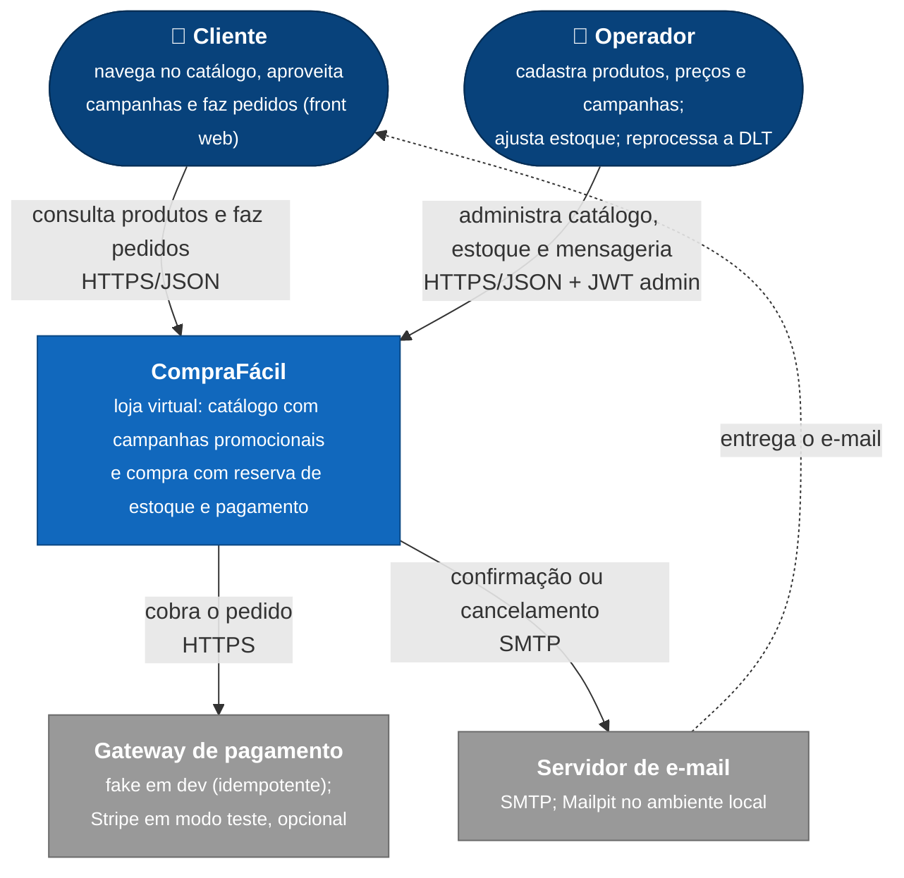
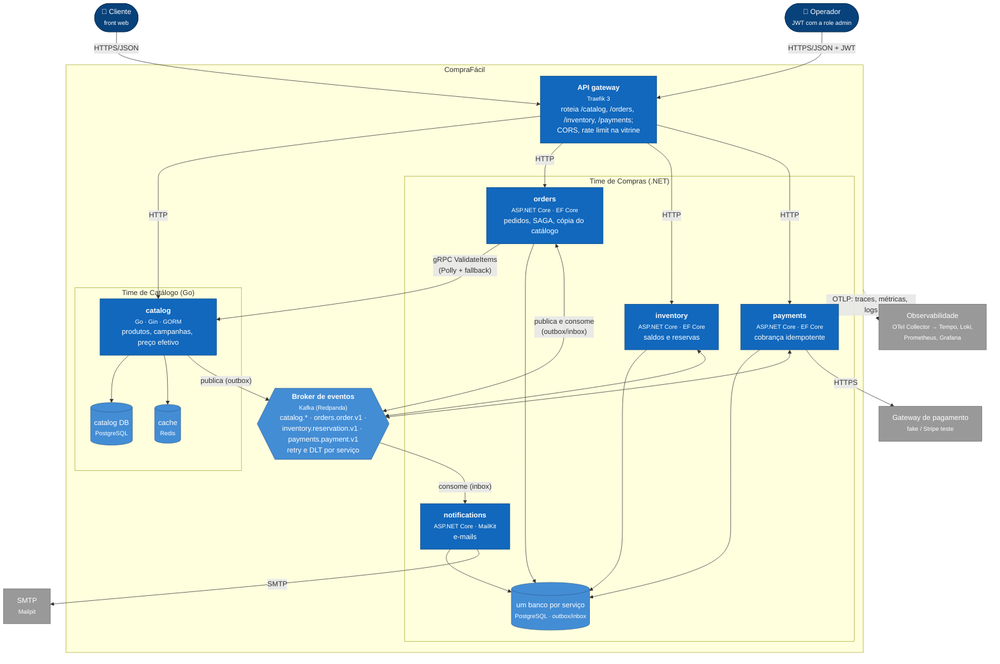
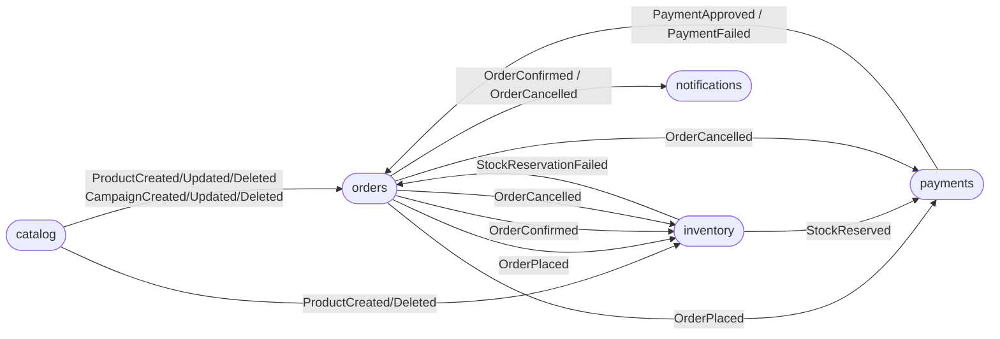

# Arquitetura (modelo C4)

Os dois primeiros níveis do [modelo C4](https://c4model.com): **contexto** (quem usa o sistema e com
quem ele fala) e **containers** (os processos e bancos, e como se comunicam). A dinâmica da compra
(SAGA) está em [`saga.md`](saga.md); as decisões, em [`../adr`](../adr).

## Nível 1 — Contexto

## Nível 2 — Containers

Cada serviço é um container próprio, com pipeline e imagem próprios (`.github/workflows/<serviço>.yml`)
e banco próprio: os bancos ficam no mesmo PostgreSQL só no ambiente local, um database por serviço,
sem acesso cruzado. Azul-escuro: pessoas; azul: containers; azul-claro: dados e mensageria; cinza:
sistemas externos. A
comunicação entre serviços é por eventos (Kafka), com uma exceção síncrona: o orders valida e precifica os
itens no catalog por gRPC, com fallback para a cópia local do catálogo (#81).

### Fluxo dos eventos

O diagrama de containers mostra quem fala com o Kafka; este mostra **quais eventos** passam entre os
serviços (contratos em [`contracts/asyncapi`](../../contracts/asyncapi)).

## Onde cada time mexe

| Time | Containers | Pipeline | Contratos que publica |
|---|---|---|---|
| Catálogo (Go) | catalog, catalog DB, cache | `catalog.yml` | `proto/catalog/v1`, `openapi/catalog.v1.yaml`, `asyncapi/catalog.v1.yaml` |
| Compras (.NET) | orders, inventory, payments, notifications e seus bancos | `orders.yml`, `inventory.yml`, `payments.yml`, `notifications.yml` | `openapi/{orders,inventory,payments}.v1.yaml`, `asyncapi/{orders,inventory,payments}.v1.yaml` |
| Plataforma | gateway, Kafka, observabilidade | `contracts.yml` | — |
