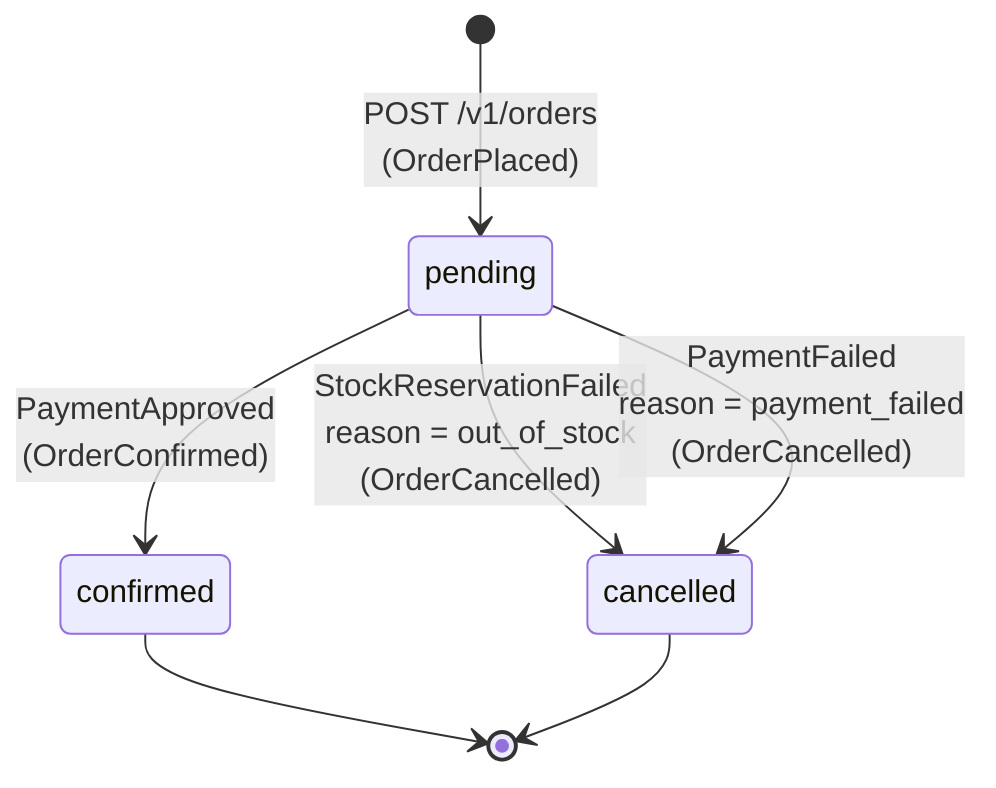
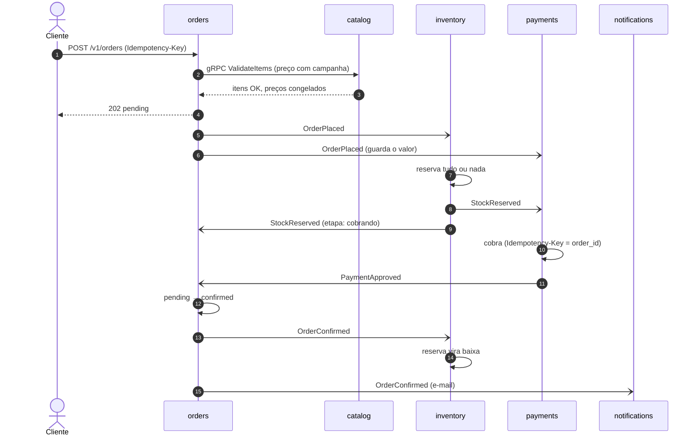
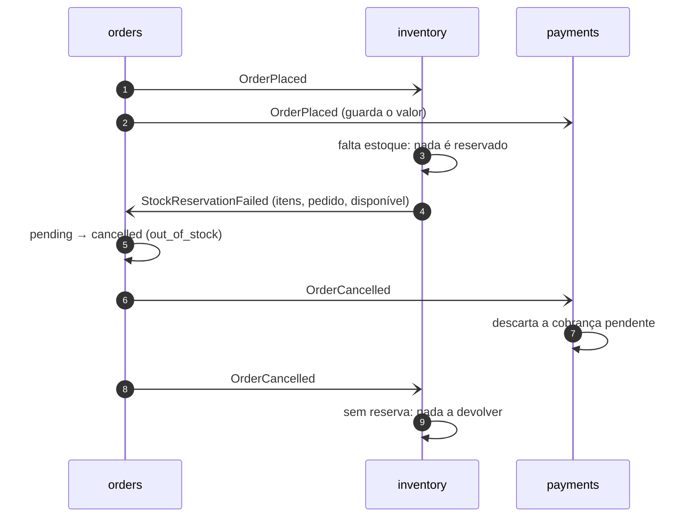

# SAGA de compra (coreografada)

Não há orquestrador: cada serviço reage aos eventos dos outros e publica os seus. Os contratos estão em
[`contracts/asyncapi`](../../contracts/asyncapi); todo evento sai pelo outbox (na transação da escrita) e
é tratado com inbox (`event_id` repetido é ignorado). O `correlation_id` (o `X-Request-ID` do
`POST /v1/orders`) atravessa a SAGA inteira; o `causation_id` aponta o evento anterior.

## Estados do pedido (orders)



Dentro de `pending`, o `stock_reserved_at` marca a etapa: nulo enquanto o inventory reserva, preenchido
quando o `StockReserved` chega e o payments está cobrando. Não é uma transição da SAGA (o orders não
publica nada por ela); serve para o cliente ver a compra andar em `GET /v1/orders/{id}/events`. Um
`PaymentApproved` ou `PaymentFailed` que chegue antes do `StockReserved` (outro tópico) já preenche a
etapa, e o `StockReserved` atrasado é ignorado.

Estados finais não mudam: um evento que chega atrasado para um pedido já `confirmed` ou `cancelled` é
registrado e ignorado. Duas réplicas aplicando resultados conflitantes ao mesmo tempo não passam juntas
(concorrência otimista pelo `xmin`): só uma transição vale e só um evento sai.

## Caminho feliz



O payments só cobra quando tem os dois fatos — o valor (`OrderPlaced`) e o estoque garantido
(`StockReserved`) — e não importa qual chega primeiro: são tópicos diferentes, sem ordem entre eles.

Rastro real no compose (eventos com `correlation_id = smoke-79-feliz`, ordenados por `occurred_at`):

```
15:17:53.178 orders    OrderPlaced     <- causado por requisição HTTP
15:17:53.538 inventory StockReserved   <- causado por OrderPlaced
15:17:54.051 payments  PaymentApproved <- causado por StockReserved
15:17:54.636 orders    OrderConfirmed  <- causado por PaymentApproved
```

Do `POST` ao pedido `confirmed`: ~1,5 s (o gateway fake simula 150 ms; o resto é o polling de 500 ms dos
relays de outbox).

## Compensação 1: sem estoque



## Compensação 2: pagamento recusado

```mermaid
sequenceDiagram
    autonumber
    participant O as orders
    participant I as inventory
    participant P as payments
    O-)I: OrderPlaced
    I->>I: reserva
    I-)P: StockReserved
    P->>P: gateway recusa
    P-)O: PaymentFailed (card_declined, insufficient_funds, ...)
    O->>O: pending → cancelled (payment_failed)
    O-)I: OrderCancelled
    I->>I: devolve a reserva ao estoque
    Note over I: publica StockReleased (registro da compensação; nenhum serviço consome)
```

## Garantias e limites

| Garantia | Como |
|---|---|
| Evento não se perde | Outbox na transação da escrita; relay publica e só então apaga |
| Efeito não se repete | Inbox por `event_id`; cobrança com Idempotency-Key; transições só a partir de `pending` |
| Estoque não fica negativo | Reserva tudo-ou-nada com concorrência otimista + `CHECK` no banco |
| Ordem por pedido | Chave da mensagem = `order_id` (mesma partição) |
| Mensagem fora do contrato não trava a fila | Vai direto para a DLT do serviço (`<serviço>.dlt`) |
| Falha num pedido não para os outros | 3 tentativas no lugar; depois `<serviço>.retry-1..3` (5 s, 30 s, 2 min) e a DLT, com reprocessamento (ADR 0003) |
| Pedido não cai com o catalog | gRPC com prazo, retry com jitter e circuit breaker (Polly); fora, preço pela cópia local do catálogo (eventos `catalog.*`) |
| E-mail sai no máximo uma vez | Notificação reservada (`sending`) antes do envio; queda no meio não reenvia |

Ainda não: pedido parado em `pending` por um serviço fora do ar indefinidamente ou por um evento parado na
DLT (timeout da SAGA).
