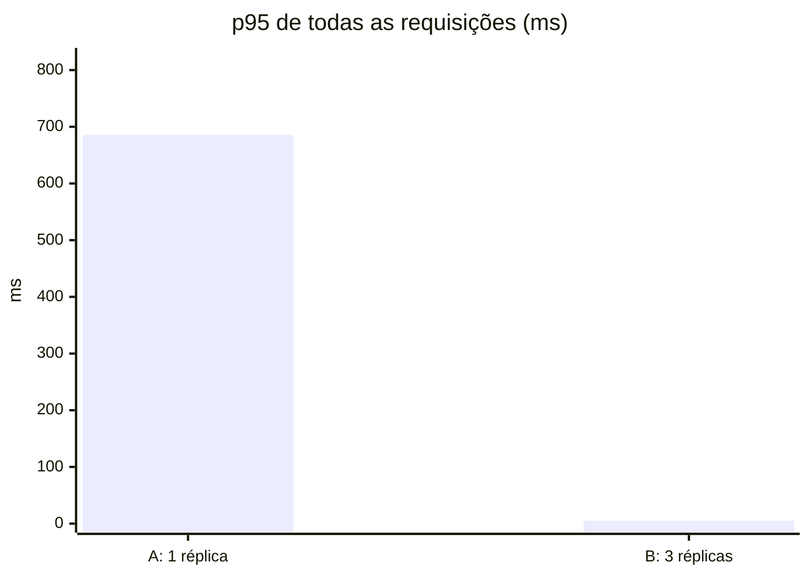
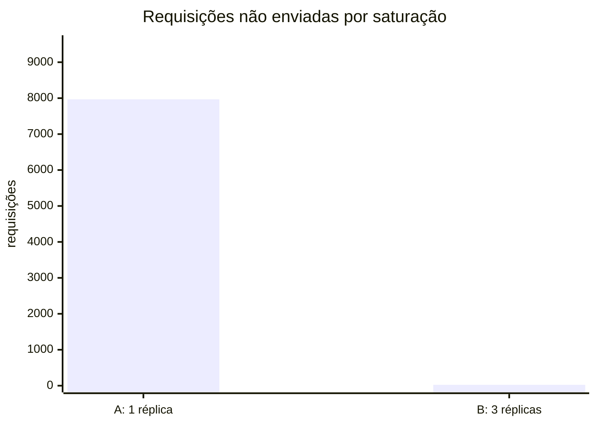
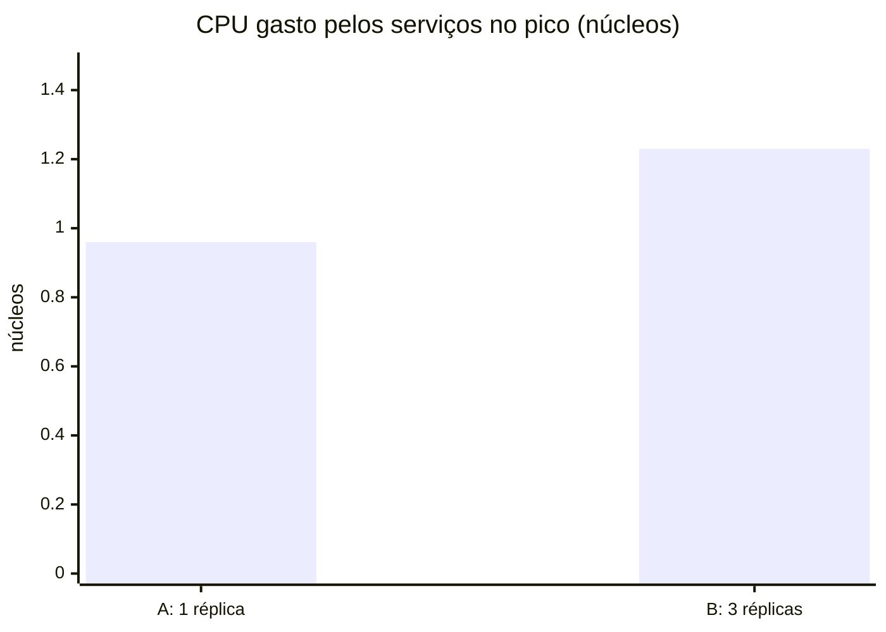

# Resultados de carga: escala independente do catálogo

Critério observável 1 do parecer (#90). Gerado por `task experiment` (`load-tests/experiment.py`) em 2026-10-22 18:12 UTC.

## Como foi medido

- **Carga:** `load-tests/k6/campanha.js`. São 90% de leitura do catálogo (55% detalhe de produto, quase todo em
  produtos da campanha; 25% listagem por categoria; buscas, categorias e campanhas) e 10% de compras
  (`POST /v1/orders`, que valida e precifica no catalog por gRPC e inicia a SAGA). A rampa vai de
  50 a **1000 req/s**, e o pico dura **2m**.
- **Recursos por réplica** (`infra/compose/compose.experiment.yaml`): catalog com **0.2 CPU** e
  256 MiB; os outros serviços com 1 CPU e 512 MiB. Postgres, Redis e Redpanda não têm limite.
- **Rodadas:** A, com uma réplica de cada serviço; B, com **3 réplicas do catalog** e o resto igual.
- **Medições:** latência e erros vêm do resumo do k6, considerando o tráfego todo, rampa incluída. CPU e
  memória são a média das amostras do `docker stats` durante o pico, somando os containers dos 5 serviços
  ("app") e só os do catalog.
- **Limite do método:** gerador de carga, serviços e infraestrutura dividem a mesma máquina. Os números servem
  para comparar as rodadas entre si, não como capacidade absoluta.

## Resultado

| Rodada | Réplicas do catalog | Req/s atendidas | Não enviadas (saturação) | p95 (ms) | p95 leitura | p95 compra | p99 (ms) | Erros | CPU app (núcleos) | CPU catalog | Memória app (MiB) |
|---|---|---|---|---|---|---|---|---|---|---|---|
| A | 1 | 703 | 7.968 | 686 | 692 | 450 | 830 | 0.001% | 0.96 | 0.20 | 798 |
| B | 3 | 744 | 24 | 5 | 1 | 9 | 8 | 0.001% | 1.23 | 0.33 | 812 |

Metas da #89: p95 < 300 ms e erros < 1%.

## Leitura

- **Latência:** o p95 foi de 686 ms para 5 ms (-99%).
- **Erros:** 0.001% → 0.001%.
- **Saturação:** com uma réplica, 7.968 requisições nem chegaram a ser enviadas (o k6 ficou sem usuários virtuais livres, porque os anteriores ainda esperavam resposta); com 3, foram 24. Por isso a vazão atendida é maior na rodada B com a mesma carga oferecida.
- **Custo:** o CPU dos serviços foi de 0.96 para 1.23 núcleos e a memória de 798 para 812 MiB. Só o catalog ganhou réplicas: orders, inventory, payments e notifications seguiram com uma.

## O que este experimento não mede: a SAGA depois do 202

O k6 mede a **aceitação** do pedido (`202`, pedido `pending`), não a conclusão da SAGA. A compra segue de
forma assíncrona, e o payments trata um evento por vez, cerca de 6 por segundo, porque o gateway fake simula
150 ms por cobrança. No pico de compras do experimento (cerca de 100 pedidos/s), a fila do payments
cresceu: depois das rodadas, o consumer group tinha mais de 170 mil mensagens atrasadas, o que significa horas
até todos os pedidos do pico serem confirmados.

Escalar o catálogo resolve a vitrine e a entrada do pedido, mas a etapa seguinte vira o gargalo. Para a
conclusão da SAGA acompanhar o pico, o próximo passo seria escalar o payments: até 3 instâncias, uma por
partição do tópico, ou processar em paralelo dentro da partição por chave de pedido. É também o argumento
para o lag dos consumers estar no painel da SAGA.

Os números brutos (resumo do k6 e as médias de recurso) estão em `load-tests/results/`.
